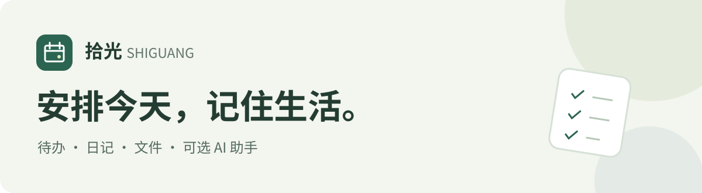
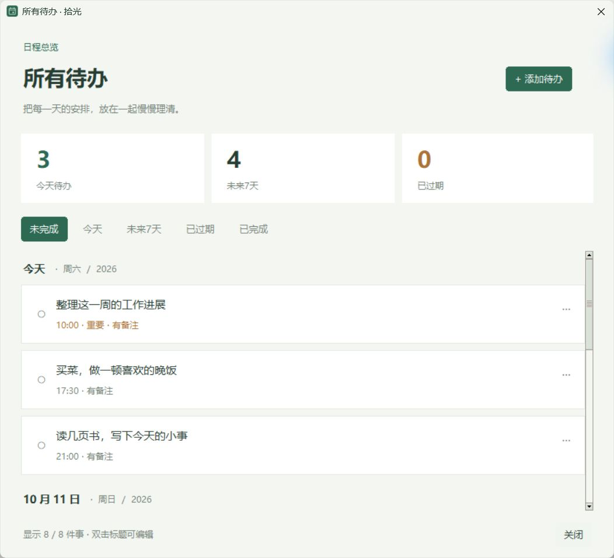

**一个放在电脑里的日历、日记本和资料夹。**

记下要做的事、突然的想法和每天的小小进展。没有网络，也能继续记录。

[**⬇ 下载 Windows 安装版 · v1.9.5 预览版**](https://github.com/jgr2021/shiguang/releases/download/v1.9.5/Shiguang-Setup-1.9.5-x64.exe)

[看产品介绍](https://jgr2021.github.io/shiguang/) · [第一次使用](docs/QUICKSTART.md) · [免安装 ZIP](https://github.com/jgr2021/shiguang/releases/download/v1.9.5/Shiguang-1.9.5-Windows-x64.zip)

**Mac 下载：** [Apple Silicon（M 系列）](https://github.com/jgr2021/shiguang/releases/download/v1.9.5/Shiguang-1.9.5-macOS-arm64.dmg) · [Intel](https://github.com/jgr2021/shiguang/releases/download/v1.9.5/Shiguang-1.9.5-macOS-x86_64.dmg) · [Mac 安装说明](MACOS-START.md)

Windows 10/11 x64 · macOS 15+ · 无需注册 · AI 可选

简体中文 · [繁體中文](docs/README.zh-TW.md) · [English](docs/README.en.md)

v1.8 实际运行界面，内容均为虚构示例。你的记录由你自己填写。

## 让拾光陪你过一个普通的日子

| 什么时候 | 可以做什么 |
| --- | --- |
| **早上，事情有点多** | 点“回到今天”，写下今天要做的几件事。重要的标一下，有约定的加上时间。 |
| **白天，想到了一点什么** | 在“当天日记”写一句话。读书笔记、工作进展、生活小事都可以，草稿会自动保存。 |
| **准备出行或推进一个项目** | 把清单、文档放到相关日期。同一个文件，可以在多个日期查看。 |
| **周末，想看看最近过得怎样** | 翻一翻日历、搜索旧记录；连接 AI 后，也可以请助手根据记录帮你回顾。 |

不用每天写得很完整。从今天的一件小事开始，就够了。

## 第一次用，做这三步

Mac 用户：下载对应芯片的 DMG，把 Shiguang.app 拖入 Applications，之后从应用程序打开。

1. **下载安装。** 点上方“下载 Windows 安装版”，完成安装后打开“拾光日历”。不用下载源码，也不用安装 Python。
2. **记下一件事。** 欢迎页选“先开始记录”，点“回到今天”，在待办输入框写下“晚上散步”，按 Enter 添加。
3. **留下一句话。** 切到“当天日记”，写下今天的一个想法，看到“已保存到本机”即可。

这三步都不需要配置 AI。完整图文步骤见 **[第一次使用](docs/QUICKSTART.md)**。

## 日历之外，给生活多留一点余地

- **修改与删除，少几步。** 紧凑编辑窗口，绿色编辑、红色删除；误点后可在本次打开期间撤销。
- **事情记在一起。** 右上角集中查看本周（周一至周日）与今天前两天的待办；其他日期仍可从月历查看。
- **日期和时间，点选就好。** 在当前窗口内点选日期与完整时间，支持全天事项。
- **资料跟着日期走。** 同一份附件关联多天，旅行清单、课程资料、项目文档都能找回来。
- **想不起完整标题，也能找找看。** 搜索标题、备注、可提取正文及常见近义词；目前不是语义向量搜索。
- **写完以后，仍然属于你。** 日记与待办存于本机；设置里可以导出完整备份。
- **用习惯的语言。** 简体中文、繁體中文和 English 可在设置里切换。

<b>再看两张实际界面：日记与待办总览</b>

### 留下今天的一点想法

### 把接下来要做的事放在一起

以上为虚构示例数据，不包含个人档案。

[查看 v1.9.5 更新说明](docs/RELEASE-v1.9.5.md)

## 想用 AI 时，再让它来帮忙

连接自己的 AI 服务后，可以在“拾光助手”里这样说：

> “帮我回顾这周做了什么，区分已完成和还没完成的事。”
>
> “明天下午想读书、收拾房间，帮我起草一下安排。”
>
> “参考我上传的旧简历和之后的成果，帮我整理一个新版本。”

**日程先给你看，确认后才写入。** 你可以改时间、删减草案、只选其中几项。聊天按 Enter 发送，Ctrl+Enter 换行。

已经使用 Codex，可以沿用本机登录；也可连接 DeepSeek、OpenAI、Claude、Gemini 等服务，填写自己的 API Key（服务商提供的连接密钥）。AI 需要网络，额度与费用由所选服务商决定。

[连接 AI 的详细步骤](AI连接指南.md) · [想先试免费额度](docs/FREE-AI.md)

## 可选：让记录跟着账号走

在设置中用 GitHub 登录，将记录同步到自己创建的私有仓库。附件单个最多 **50 MiB**，当前附件合计最多 **500 MiB**；Git 历史另计。已有同步设备需使用 **1.9.2 或更新版本**。不需要同步时，继续完全离线使用。

[普通用户：同步上手与常见问题](docs/SYNC-QUICKSTART.md) · [同步范围与详细说明](GitHub同步说明.md)

## 下载前，你可能想知道

**不联网能用吗？** 能。日历、待办、日记、附件和本机搜索都能离线使用；AI 问答需要联网。

**要注册账号吗？** 不需要。下载安装包和本机记录均无需 GitHub 登录。设置中的 GitHub 私有仓库同步是可选预览功能，已内置公开应用配置，用户授权自己的私有仓库即可；Mac 与双设备同步仍待验证。

**日记会自动发给 AI 吗？** 不会因为写日记就自动发送。你使用助手提问时，问题、近期对话和相关档案内容会发送给你选择的服务商。

**会到点提醒、自动同步手机吗？** 当前没有到点弹窗提醒或手机版。GitHub 同步仍在预览阶段，尚未完成真实双设备验证；可继续在设置中导出备份。

**现在是什么版本？** v1.9.5 预览版。Windows 安装包尚未签名；Mac 包没有 Apple Developer ID 签名或公证。本次已构建程序与分发包，未运行新版本自动化测试或完整界面验收；已核对单台 Windows 的文字记录与私有仓库一致，容量边界与双设备同步仍待验证。

[更多常见问题](docs/FAQ.md) · [版本更新与下载文件](https://github.com/jgr2021/shiguang/releases/tag/v1.9.5) · [本版完成范围与待验证事项](docs/QA-v1.9.5.md)

## 一起把它做得更顺手

哪一个按钮让你犹豫了？哪一件日常小事，希望拾光帮你少费一点心？

[告诉我们遇到的问题](https://github.com/jgr2021/shiguang/issues/new?template=problem.yml) · [分享你的使用场景](https://github.com/jgr2021/shiguang/issues/new?template=idea.yml)

反馈需要 GitHub 账号。请隐去日记原文、私人文件和密钥。

---

开发、进阶能力与当前边界

- [从源码运行与构建](docs/BUILD.md) · [版本记录](CHANGELOG.md)
- [DeepSeek 接法与 WorkBuddy 协作可行性](docs/DEEPSEEK-WORKBUDDY.md)
- [完整使用说明](开始使用.txt) · [AI 连接指南](AI连接指南.md)
- 云文件通过已有网盘客户端的本机同步文件夹导出。另有可选的 GitHub 私有仓库同步预览，详见 [同步说明](GitHub同步说明.md)；AI 密钥和助手聊天不参与该同步。
- API 模式没有内置网页搜索；扫描件没有 OCR。Codex 其他任务、GitHub 项目、ChatGPT 与 WorkBuddy 尚未自动同步。
- 公开源码与分发包不包含个人日记、凭据或原作者的自动任务。项目尚未指定开源许可证；第三方组件遵循各自许可证。

