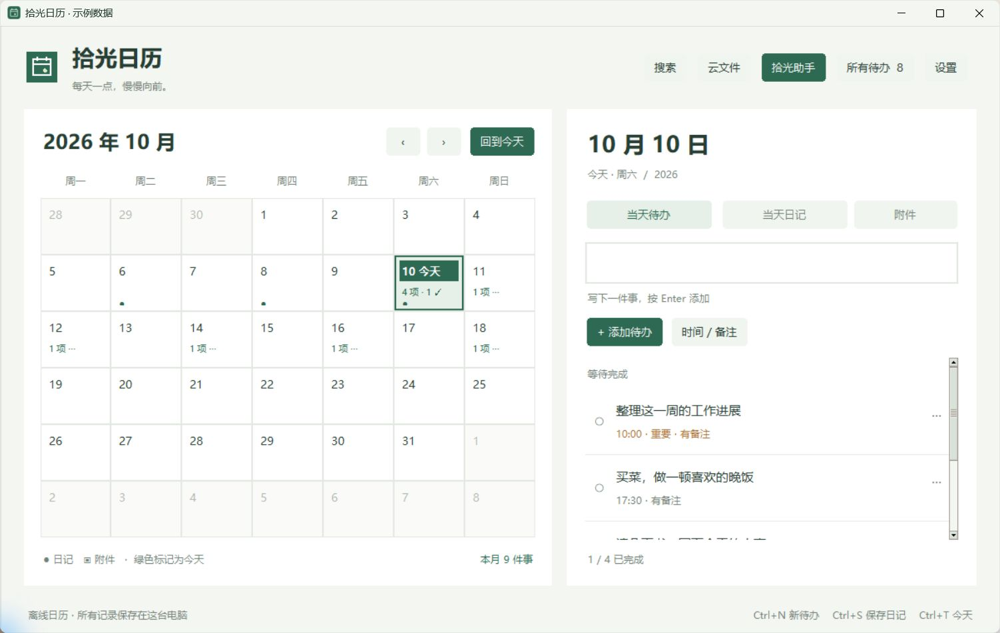
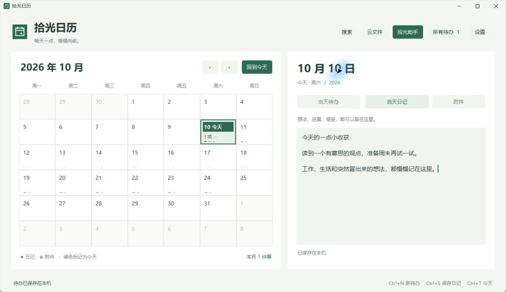

# 第一次使用拾光

**先记下一件事。AI 可以以后再配置。**

[返回介绍](../README.md) · [常见问题](FAQ.md)

## 1. 下载并打开

| 你想怎样使用 | 下载哪个 |
| --- | --- |
| 像普通软件一样安装，有桌面入口 | **[Windows 安装版（推荐）](https://github.com/jgr2021/shiguang/releases/download/v1.9.2/Shiguang-Setup-1.9.2-x64.exe)** |
| 解压到文件夹后运行 | [免安装 ZIP](https://github.com/jgr2021/shiguang/releases/download/v1.9.2/Shiguang-1.9.2-Windows-x64.zip) |

Windows 安装包适用于 Windows 10/11 x64。Mac 用户选择 [M 系列 DMG](https://github.com/jgr2021/shiguang/releases/download/v1.9.2/Shiguang-1.9.2-macOS-arm64.dmg) 或 [Intel DMG](https://github.com/jgr2021/shiguang/releases/download/v1.9.2/Shiguang-1.9.2-macOS-x86_64.dmg)，适用于 macOS 15+。打开 DMG，将 App 拖入 Applications；详见 [Mac 安装说明](../MACOS-START.md)。目前没有手机版。

- **安装版：** 下载 `.exe` 文件，按安装向导完成，然后打开桌面的“拾光日历”。
- **ZIP：** 先完整解压，再双击 `Shiguang.exe`。把旁边的 `_internal` 文件夹留在原处。
- 这是预览版，安装包尚未签名，系统可能显示未知发布者。遇到安装问题可[提交反馈](https://github.com/jgr2021/shiguang/issues/new?template=problem.yml)。

在 GitHub 页面找文件时，选择上述安装包或程序 ZIP；`Code → Download ZIP` 和 `Source code` 是源码，普通使用者无需下载。

## 2. 安排今天的一件事

欢迎页选择语言，点击 **先开始记录**。

1. 点击 **回到今天**。
2. 在右边 **当天待办** 的输入框写下“晚上散步”。
3. 按 **Enter**，它就会进入当天的列表。
4. 想加具体时间，点 **时间**，直接在当前窗口内选择。事情做完后，点击它左边的圆圈。

待办保存到本机，不需要网络。日期与时间直接点选，支持全天事项。设置时间用于安排；当前版本没有到点弹窗提醒。

## 3. 留下一句话

点击 **当天日记**，写下一个想法、一件小事，或者今天推进了什么。看到 **已保存到本机**，草稿就已保存。

日记会自动保存在本机，不需要另外点击归档。以前保存的历史档案仍可从搜索中查看。

## 以后慢慢用到这些

| 想做的事 | 从哪里开始 |
| --- | --- |
| 记录明天或下周的安排 | 直接点日历上的日期 |
| 看接下来还有什么没做 | 顶部“所有待办” |
| 把清单、课程资料或文档放到某天 | 右边“附件”；可关联多个日期或日期区间 |
| 找以前记过的内容 | 顶部“搜索”，也可以试备注或正文里记得的几个词 |
| 保存一份完整备份 | “设置 → 导出完整备份” |
| 换成繁体中文或英语 | “设置”里的语言选项 |

## 需要账号同步吗？

不登录 GitHub 也能一直使用本机版。v1.9.2 的「设置 → 账号与同步」是可选预览入口，已内置公开 GitHub App 配置。需要同步时登录并授权自己的私有仓库；单附件50 MiB、合计500 MiB，所有同步设备需一起升级。Mac 与双设备同步仍待验证。不需要同步时可以直接跳过。详情见 [GitHub 同步说明](../GitHub同步说明.md)。

## 想试试 AI？

打开 **设置 → AI 服务与 Token 设置**。如果你已经使用 Codex，可以连接本机登录；其他服务需要自己的 API Key。

连接完成后，打开 **拾光助手 → 帮我安排日程**，试着说：“明天下午安排半小时读书，再留半小时收拾书桌。”

助手先给出草案。核对日期、时间和内容，勾选需要的条目，再点 **确认写入日历**。不想现在安排，可以保存草稿稍后处理。

聊天：**Enter 发送，Ctrl+Enter 换行**。AI 需要联网，可能消耗你的服务商额度。

[连接 AI 的步骤](../AI连接指南.md) · [免费方案说明](FREE-AI.md)

---

不用一次学会全部功能。今天能记下一件事，拾光就已经开始帮忙了。
