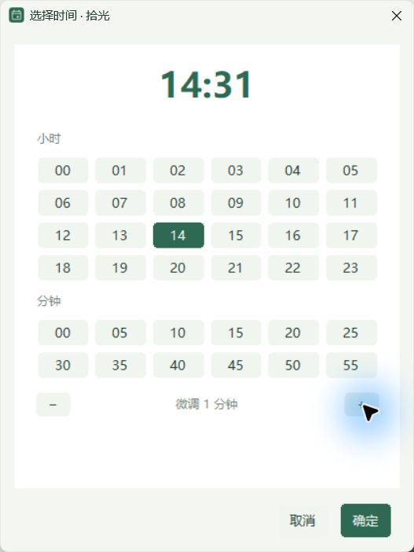
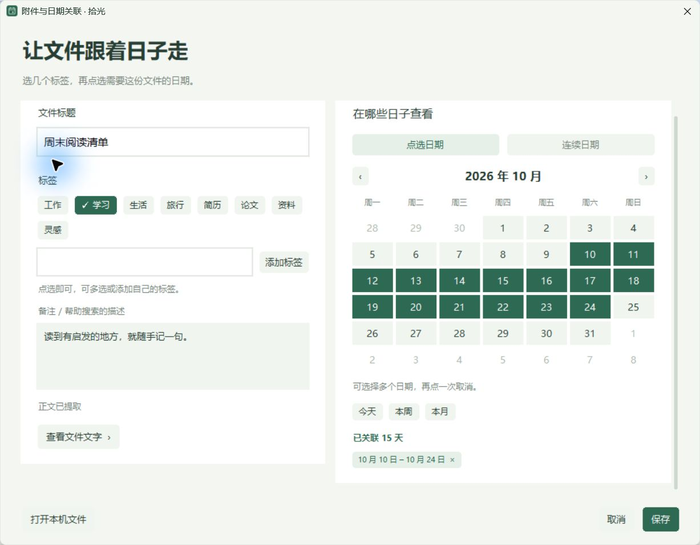

# 拾光 v1.8.0 · 点选日期与时间

安排一件小事，无需记住输入格式。

- **日期点月历**：普通待办与 AI 日程草案共用日期选择，今天、明天一键选择。
- **时间直接点选**：小时、常用分钟按钮，支持全天和 1 分钟微调。
- **附件更好整理**：标签直接多选；月历点选多天、多段连续范围。移除两个选填输入项。
- **日记写完即保存**：主页移除归档按钮，旧历史记录仍可搜索。
- **细滚动条**：简化长表单的视觉，保存和取消保留在底部。

## 下载

- [Windows 安装版](https://github.com/jgr2021/shiguang/releases/download/v1.8.0/Shiguang-Setup-1.8.0-x64.exe)
- [免安装 ZIP](https://github.com/jgr2021/shiguang/releases/download/v1.8.0/Shiguang-1.8.0-Windows-x64.zip)

Windows 10/11 x64，简体中文 / 繁體中文 / English。更新前可在设置导出备份。

39 项自动检查通过，并实际检查了日期选择、精确分钟保存、附件标签与日记页面。完整范围见 [验证记录](QA-v1.8.0.md)。

本版仍为未签名预览版，尚未完成全新电脑安装验证。基本记录离线可用，在线 AI 使用自己的服务商额度；没有内置共享 Token、到点提醒或自动跨设备同步。
